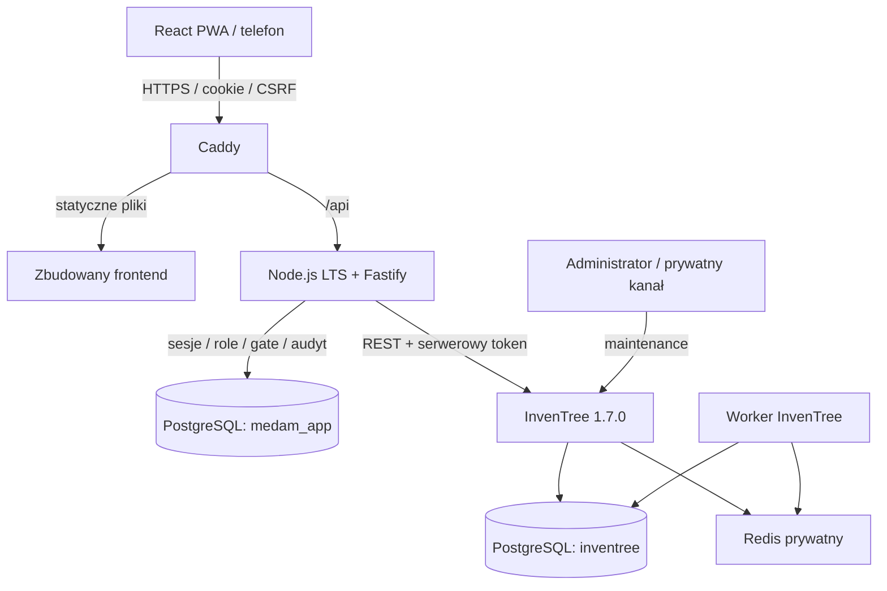

# Architektura i model danych — projekt

## Przepływ i granice zaufania

Jedna instancja PostgreSQL jest dopuszczalna, z osobnymi bazami, właścicielami,
hasłami i uprawnieniami. Rola API nie łączy się do bazy InvenTree, a rola InvenTree
do bazy aplikacji. Osobna rola wykonuje migracje aplikacji. Publiczne są tylko
HTTPS PWA/API i niezbędny dostęp SSH. InvenTree, PG, Redis i metryki są prywatne.

React nigdy nie zna tokenu InvenTree. Fastify nie jest dowolnym proxy REST: ma
zamknięte endpointy i własne DTO. Odczyty ilości, LOT, EXP, units, statusów i
lokalizacji pochodzą z InvenTree. Nie powstaje synchronizowana, edytowalna kopia
zapasu. Audyt może przechowywać żądaną ilość i potwierdzony efekt konkretnej operacji;
nie służy do obliczania bieżącego stanu.

## Wersje i struktura

Stan oficjalnych rejestrów sprawdzony 2026-11-07:

| Element | Kandydat do przypięcia | Potwierdzenie |
| --- | --- | --- |
| Node.js | 26.13.0 LTS Lithium | [oficjalny indeks](https://nodejs.org/dist/index.json) |
| pnpm | 12.18.0 | [npm](https://registry.npmjs.org/pnpm/latest) |
| Fastify | 5.12.8 | [npm](https://registry.npmjs.org/fastify/latest) |
| React | 19.3.1 | [npm](https://registry.npmjs.org/react/latest) |
| Vite | 8.3.6 | [npm](https://registry.npmjs.org/vite/latest) |
| Zod | 4.6.7 | [npm](https://registry.npmjs.org/zod/latest) |
| Vitest | 5.1.0 | [npm](https://registry.npmjs.org/vitest/latest) |
| InvenTree | 1.7.0, API v570 | [audyt API](03-inventree-api.md) |
| PostgreSQL/Redis | 17 / 7 jako baza zgodności z oficjalnym Compose | [infrastruktura](06-infrastructure.md) |

To dobór wstępny, nie przetestowany lockfile. Przy implementacji ponownie
sprawdzimy poprawki bezpieczeństwa, zgodność bibliotek i digesty obrazów. Node 26
jest docelowy; środowisko audytu ma Node 24.22.1. Nie instalowano zależności aplikacji.
Drizzle wybrano do jawnych migracji SQL i prostych transakcji PostgreSQL.
Bez mikroserwisów, własnej kolejki Redis i bez synchronizacji stanów magazynowych.

## Model aplikacji

UUID są generowane standardową biblioteką. Czasy zdarzeń: `timestamptz` UTC;
wyświetlanie i polityka dat EXP: `Europe/Warsaw`. EXP pozostaje datą bez godziny.
Numeryczne PK InvenTree są referencjami zewnętrznymi, nie FK do jego tabel.

| Tabela | Relacje, walidacja i indeksy |
| --- | --- |
| `roles` | Klucze `medic`, `warehouse_manager`, `admin`; bez uprawnień nadawanych przez frontend |
| `users` | UUID PK, znormalizowany login UNIQUE, hash Argon2id, role FK, active, password_version, created_at |
| `warehouse_mappings` | location PK UNIQUE, code UNIQUE MAG-00…MAG-11, enabled, identyfikator instancji InvenTree; bez zapasów |
| `user_warehouse_assignments` | user FK, mapping FK, valid_from/to; częściowy UNIQUE(user_id) WHERE valid_to IS NULL; wyłącznie admin zmienia |
| `sessions` | Hash nieprzewidywalnego tokenu UNIQUE, user FK, idle/expires/revoked_at, dane CSRF; bez tokenu plaintext |
| `password_reset_tokens` | Hash UNIQUE, user FK, expires/consumed_at, autor inicjacji; atomowe jednorazowe wykorzystanie |
| `idempotency_records` | operation UUID PK, actor FK, kind, key, hash kanonicznego requestu, stan, referencje upstream, bezpieczny wynik; UNIQUE(actor, kind, key) |
| `inventory_mutation_gate` | Dokładnie jeden rekord `inventory`; nullable operation FK; trwała blokada wszystkich mutacji, bez TTL zwalniającego |
| `application_audit_events` | UUID PK, operation FK, actor FK, action, resource refs, outcome, timestamps; runtime może INSERT/SELECT, nie UPDATE/DELETE |
| `problem_reports` | UUID, reporter FK, captured location, opcjonalnie stock PK, kategoria, opis ograniczony, status i czasy; brak automatycznego ruchu stock |
| `warehouse_product_policies` | UNIQUE(mapping, part PK), minimum, allowed quantum; to progi i reguły, nie bieżąca ilość |

Polityki minimalnych stanów są konfiguracją: `Part.minimum_stock` InvenTree jest
globalnym progiem produktu i nie zastąpi indywidualnego minimum magazynu. Jednostka
pozostaje w InvenTree. Reguła ilościowa aplikacji może zabraniać ułamków dla ampułek,
ale nie może samodzielnie przeliczać opakowań bez zatwierdzonej definicji.

Indeksy: audyt `(actor_user_id, occurred_at, id)`, `(operation_id)`;
zgłoszenia `(reporter_id, created_at, id)`; operacje `(state, updated_at)`;
sesje `(user_id)` i `(expires_at)`. Historia i eksport korzystają z keyset pagination,
zawsze z autoryzacją użytkownika. Readiness sprawdza mapowanie lokalizacji i zgodność
wersji/API; brak mapowania lub niemożność odczytu nigdy nie znosi filtra magazynu.

Migracje Drizzle zostaną dodane i sprawdzone na czystej bazie i na kopii testowej.
Nie wykonano migracji. Audyt/retencja mają osobne ograniczone role. Kasowanie
użytkownika przez dezaktywację, nie kasowanie śladów operacji. Minimalne tombstone
idempotencji przetrwają usunięcie treści żądań, aby stary replay nie wykonał mutacji.

## Lokalizacje i bootstrap

| Kod | Przeznaczenie | Powiązanie użytkowników |
| --- | --- | --- |
| MAG-00 | Magazyn główny | Magazynier/admin |
| MAG-01…MAG-10 | Dziesięciu ratowników | Jeden aktywny przydział do zwróconego location PK |
| MAG-11 | Gabinet | Magazynier/admin; konto gabinetu wymaga osobnej decyzji o roli i zakresie |

Bootstrap przed utworzeniem czegokolwiek pobiera pełną paginowaną listę lokalizacji,
wykrywa istniejące kody i duplikaty. Jeśli kod jest jednoznaczny, zachowuje jego PK;
duplikaty zatrzymują procedurę do wyjaśnienia. Po utracie odpowiedzi POST nie tworzy
ponownie lokalizacji w ciemno. Nie zakłada PK=01 dla MAG-01. Mapowania trafiają do
bazy aplikacji i są weryfikowane przez API. Żadna lokalizacja jeszcze nie powstała.

Przygotowanie importu: `name, units, lot, exp, quantity, warehouse_code`, walidacja
plików bez zapisu, raport błędów, zatwierdzona próbka na staging, dopiero potem
idempotentny plan przyjęć przez wspólny protokół. `Part` i `StockItem` to różne
zasoby: jeden produkt może mieć wiele partii i pozycji w różnych lokalizacjach.

## Interfejs PWA

Stan magazynu: preparat, jednostka, ilość, LOT/EXP, minimum i flagi ostrzeżeń.
FEFO sortuje wyłącznie partie dopuszczone do użycia. Wyszukiwanie nie opuszcza
dozwolonej lokalizacji; filtry upstream są generowane przez backend.

Rozchód: produkt → partia → bieżąca ilość/EXP → dodatnia ilość → potwierdzenie →
trwały status operacji. Przycisk blokowany podczas żądania; utrata sieci prowadzi
do sprawdzenia UUID. Zgłoszenie szkody nie zmienia ilości. Historia pokazuje własne
operacje. Instalacja na iOS i Android wymaga HTTPS, manifestu, ikon i testów na
telefonach. Service worker obsługuje tylko statyczne zasoby, bez prywatnego cache,
background sync i offline rozchodów. Szczegóły sesji i spójności w rozdziale 04.
